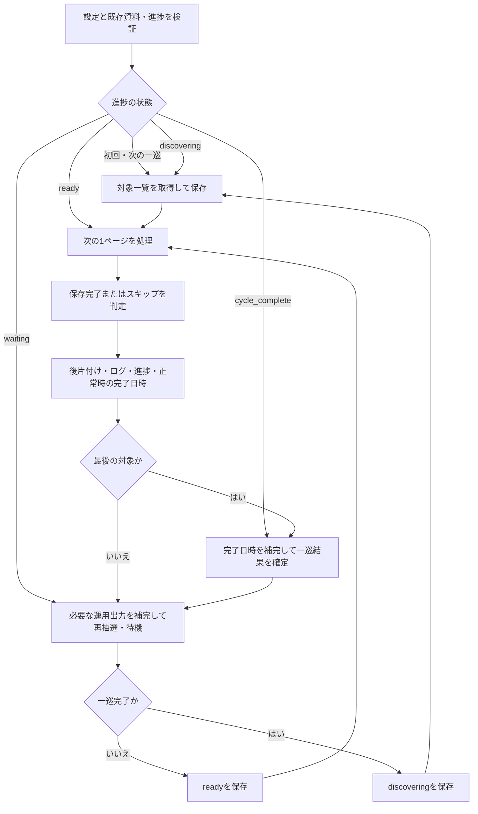

# 要件定義書・基本設計書

2026-10-26整理。本書は動作仕様の正本とし、合意済み要件・設計案・確認済みの事実・未確認事項を区別する。

| 範囲 | 位置付け |
| --- | --- |
| 1～13節 | 目的・共通要件。段階によって異なる動作は本文に明記 |
| 14～16節 | 完成済みの1ページ取得版の基本設計・検証状況 |
| 18節 | 複数ページ版の合意済み要件 |
| 19節 | 複数ページ版の基本設計案。サイト固有の確定条件は19.10節 |

節番号は既存の参照を維持する。17節は欠番で、本実装の確認記録は[詳細設計17節](detailed-design.md#17-本実装の確認2026-10-25)にある。実験の経緯・手順・実行IDは[検証記録](../validation/MULTI_PAGE_CHECKS.md)を参照する。

## 1. このアプリケーションの目的
- BlackLineというSaaS製品のドキュメントをスクレイピングしRAGに使えるMarkdownとして保存する。
- ドキュメントはWebで公開されているがログインが必要。
- 人がブラウザ(Chrome)でログインし、そのセッションを利用し、BlackLineドキュメントをクロールする。

## 2. 利用者と利用目的
- 利用者は、ユーザー本人と同じ会社に所属するチームメンバー。
- 保存したドキュメントは、本人とチームメンバーが使用するAgentのRAG用資料として利用する。
- 当面のAgentはMicrosoft Copilot Studio、RAG用資料の保管先はSharePointを予定する。
- 将来別のRAG基盤へ切り替えた場合も、保存したMarkdownをそのまま再利用できることを目指す。保存形式は特定製品に依存させない。各基盤への取り込み可否は別途検証する。

## 3. 取得対象と段階的な開発範囲
- 起点URLは `settings.toml` で指定し、exeの変更・再ビルドなしで変更可能とする。初期設定値は https://docs.blackline.com/docs/ja/consolidation-1 とする。
- 第1段階：起点URLの1ページを取得し、Markdownと画像を保存し、監視用ファイルの完了日時を更新して正常終了する。
- 第2段階：設定した起点カテゴリとその配下を対象に、左ペインのメニュー順で親→子孫→次の同階層と取得する。一巡後は設定時間を待って先頭から繰り返す（2026-10-25合意、18節）。従来の「金融クローズを優先」は、取得したいカテゴリを起点に設定する運用へ変更し、範囲外へ移動したりメニュー順を変更したりしない。
- ページ間は、現在ページのすべての処理を完了してから、設定した時間を待って次ページの取得を開始する。基準待機時間は`settings.toml`で秒単位に設定可能とし、既定値は180秒。待機ごとにランダムな揺らぎを加え、揺らぎの幅も秒単位で設定可能、既定値は±10秒とする（2026-10-25合意）。スキップ後も一巡後も共通の設定を1回だけ適用する。

## 4. 画面・DOMから確認した事項

- 左ペインは階層メニューで、カテゴリ型と記事型のページがある。
- 起点Consolidationの本文には、設定ガイドへのリンク・記事数・公開日・概要がある。
- 保存HTMLに不足した描画後の本文・メニューは、追加提供されたDOMで確認した。本文候補と階層抽出の根拠は詳細設計12節に記録する。
- 1ページ取得の本文・画像・表変換は受入済み。複数ページ向けの展開・スクロール・記事ID照合は限定観測の段階で、一般的な全件列挙を確認済みとは扱わない（19.10・19.11節）。

## 5. 残る確認と対象外の運用

- 複数ページ版のサイト固有の未確認事項は19.10節に集約する。実装・回帰・配布確認は19.9節と詳細設計17.3節に分ける。
- Copilot Studioでの画像・相対パス・YAMLフロントマターの扱いは別途確認する。MarkdownのRAG利用自体はユーザー確認済み。
- 元サイトで削除・対象外となった記事や、差し替え後の旧画像の自動削除は行わない。将来整理する場合は別途要件を定める。

## 6. 用語の確認状況
- 「金融クローズ」：英語名はFinancial Close（ユーザー確認済み）。公式ページに基づく説明と確認範囲は [用語集](glossaries/金融クローズ.md) を参照する。配下の一部展開は観測したが、全構成と起点URLは未確定。今回の巡回は設定した起点カテゴリに限定し、この名称を使った自動優先処理は行わない。

## 7. 保存する内容（合意済み）
- ページタイトルと本文を保存し、見出し・リンク・表を維持する。
- 保存対象は中央の記事領域とし、サイト共通のヘッダー・左メニュー・検索欄などは本文から除外する。左メニューから取得するメニュー階層はフロントマターに記録する。
- 文書の保存形式はMarkdownのみとし、PDFなど別形式への変換・保存は行わない。
- 保存先フォルダは左ペインのメニュー階層に沿った構成とする。記事自身と親階層の具体的なパスへの対応は15.1節で定義する。
- Markdownのファイル名は、人が読むことと同名タイトルの記事を区別することを考慮し、`タイトル-元URLのSHA-256ハッシュ先頭8桁.md` とする。ハッシュは16進表記を用いる。
- ファイル名用ハッシュは本文の更新判定用ハッシュと分け、本文の更新だけではファイル名が変わらないようにする。
- 同じ保存先でファイル名が衝突した場合は、既存ファイルの元URLと照合する。別URLの記事の場合はハッシュ部分の桁数を延長し、別記事を上書きしない。URLの正規化・具体的な延長規則は15.1節で定義する。
- 画像は別ファイルとして保存し、Markdownから `` で参照する。Markdownと画像をまとめて同期・移動する。
- 画像ごとのハッシュを保持し、画像データだけの更新も検出できるようにする。
- 元URL、取得日時、メニュー階層をYAMLフロントマターに記録する。
- YAMLフロントマターの `created_at` に、本アプリがその記事の初版を作成した日時をタイムゾーン付きISO 8601形式で記録する。元サイトの公開日時ではない。同じURLの記事の更新やタイトル・階層変更時にも初版の `created_at` を引き継ぎ、変更しない。
- 見出しと本文を結合した文字列のハッシュ値を保持し、後から変更を検出できるようにする。
- 同じURLを再取得した場合は既存ファイルと比較し、本文・画像に変更がある場合だけ更新する。この動作は初期段階の再実行から適用し、将来の全ページ巡回でも利用する。
- 同じURLの記事のタイトル・メニュー階層が変更された場合は、新しいタイトル・階層に対応するファイル名・配置へ変更し、古いファイルを残して記事が重複しないようにする。移動に伴う画像参照も維持する。
- 保存先はユーザーが指定するPC内のフォルダとする。SharePointと同期するOneDriveフォルダを想定する。
- アプリはローカルファイルとして保存し、クラウドへのアップロードはOneDriveの同期に委ねる。

## 8. 一時領域から最終保存先への保存・更新（合意済み）
1. ウェブページから取得した情報をMarkdown化し、YAMLフロントマターを付与して一時領域に保持する。この時点では最終保存先のMarkdownを上書きしない。
2. メニュー階層と命名規則で決まる最終保存先に、同名ファイルが存在するか確認する。
3. 同名ファイルがなければ、一時領域のMarkdownを最終保存先に保存する。新規記事の場合は `created_at` に初版作成日時を記録する。ただし、タイトル・階層変更による同じURLの旧ファイルがある場合は、既存の移動・重複防止要件も適用し、旧ファイルの `created_at` を引き継ぐ。
4. 同名ファイルがある場合は、既存ファイルのYAMLフロントマターにある元URLを確認する。別URLであれば上書きせず、合意済みのハッシュ桁数延長による衝突回避を行い、保存先を再判定する。
5. 同じURLであれば、既存の更新判定用ハッシュ値と今回の値を比較する。ファイル名用のURLハッシュを更新判定には使わない。
6. 更新判定用ハッシュ値が変更されていた場合は、一時領域にあるMarkdownのYAMLフロントマターに既存ファイルの `created_at` を引き継ぎ、`updated_at` に今回の更新日時を記録し、そのMarkdownで最終保存先の既存ファイルを上書きする。日時はタイムゾーン付きISO 8601形式とし、元サイトの更新日時ではなく、本アプリが変更を検出して保存する際の日時とする。画像の変更も合意済みの更新判定の対象とする。
7. 本文・画像・タイトル・メニュー階層に変更がなければ、既存Markdownを上書きしない。ページ処理が正常に完了した場合は、保存の有無によらず監視用ファイルの完了日時を更新する。

- 初回保存時の `updated_at`、一時領域、画像とMarkdownの保存順序は15節で具体化する。変更がなく上書きを省略する場合は、既存の `updated_at` も変更しない。

## 9. 保存形式の基本方針
- 画像の配置、フロントマターのキー、ハッシュ計算と比較方法は15節で定義する。
- 取得日時などのフロントマターは内容ハッシュの対象に含めない。
- 本文・画像・タイトル・メニュー階層に変更がない場合は既存Markdownを上書きしない。フロントマターの取得日時は保存した内容の取得日時として維持し、処理完了の監視用日時とは区別する。

## 10. 利用先での確認状況
- 2026-10-25にユーザーより、Copilot StudioでMarkdownをRAGとして利用できることを実際の製品で動作確認済みとの報告があった。本アプリはこの確認結果を前提とする。
- 相対パスで参照する画像の内容理解と、YAMLフロントマターの構造化メタデータとしての利用可否は、この確認結果に含まれるか未確認。

## 11. 実行環境・操作・配布（合意済み）
- 対象OSはWindows 11のみとする。
- 起点URL・保存先など各種設定は外部設定ファイル `settings.toml` で指定する。初期段階の設定キー・配置規則は14.3節で定義する。
- アプリは実行中にユーザーの操作を介さないバッチ形式とする。設定画面や取得開始ボタンによる操作は設けない。
- 実行前にユーザーがChromeでログインを済ませ、そのChromeを起動したままアプリを実行する。アプリはそのログイン済みセッションを利用する。
- PyInstallerでexe化し、exeと外部設定ファイルを一緒に配布する。利用先でPythonを別途インストールせずに実行できる形とする。
- ビルド成果物は `dist/` 配下のビルドごとに一意なサブディレクトリへ保存し、以前のexeを上書き・削除しない。

## 12. エラー処理・通知の責務（合意済み）
- ログインセッションが切れた場合、エラーログをファイルに出力して異常終了する。ユーザーがChromeで再ログインした後、アプリを再実行する運用とする。
- ログイン切れを含むすべてのエラーは、`settings.toml` で指定したローカルPC上のフォルダへファイルとして出力する。
- エラーログの出力先は、取得したMarkdown・画像の保存先とは別のSharePoint上のパスと同期するローカルフォルダを想定する。
- Power AutomateがSharePoint上のエラーログ用フォルダを監視し、Teamsへの投稿とユーザーへの通知を行う運用を想定する。
- アプリの責務はローカルフォルダへのエラーログ出力までとする。SharePointへの同期、Power Automateの監視、Teamsへの投稿・通知はアプリの責務に含めない。
- ログには認証情報・セッションの秘密値を出力しない。
- エラー1件につき1ファイルを作成し、日時・対象URL・処理内容・エラー内容を記録する。
- 初期段階では、取得・変換・画像保存のいずれかに失敗した場合、エラーログを出力して異常終了する。
- 初期段階は一時的な通信エラーやHTTP 401・403を含め、自動リトライせず異常終了する。
- 複数ページ版では、ページの通信・本文抽出・変換・画像取得の失敗はスキップし、次の一巡で再取得する。HTTP 401/403やローカル出力失敗等は全体停止を優先する。主文書の301・302・303・307・308と取得先URL不一致も保存せずスキップする。明示画像の301・302・303・307・308もページ全体の更新を見送ってスキップする（追加4種は2026-10-26ユーザー合意）。詳細な分類は19.8節を正とし、初期版の動作と混同しない。
- スキップログは既存の`error_dir`へ、全体停止ログと項目を区別したJSONで1件1ファイル出力する。形式と監視側への影響は19.7節に定める。
- 設定ファイルの不備や指定したエラーログ出力先への書き込み失敗時は、exeと同じフォルダへのエラーログ出力を試み、標準エラーにも表示する。
- 異常終了した場合は処理を停止し、人が再起動する。アプリによる自動再起動は行わない。この運用は初期段階・後続段階の双方に適用する。

## 13. ページ処理完了の監視（合意済み）
- 1ページの処理が正常に完了するたびに、`settings.toml` で指定するローカルファイルへ完了日時を上書きする。履歴の追記形式にはしない。
- 初期段階ではMarkdownと必要な画像の保存後に完了日時を更新する。取得・変換・画像保存の失敗時は完了日時を更新しない。
- 別のPower Automateがこのファイルを定期的に監視し、長時間更新されていなければTeamsへの投稿などでアプリの停止を通知する運用を想定する。
- アプリの責務は指定ファイルへの完了日時の上書きまでとし、監視間隔・停止判定・通知処理はPower Automate側で管理する。
- 完了日時はタイムゾーン付きISO 8601形式の文字列を1行で保存する（例：`2026-10-25T15:00:00+09:00`）。
- 将来の巡回では、変更がなくMarkdown・画像の保存を省略したページも、確認が正常に完了すれば完了日時を更新する。
- 完了日時の書き込みに失敗した場合は、エラーログを出力して異常終了する。異常終了後は他の異常終了と同様、処理を停止して人が再起動する。

## 14. 初期段階の基本設計

本節以降は1ページ取得の基本設計とする。前節までの合意済み要件を具体化する。1ページ取得の初期バージョンは完成し、2026-10-25にユーザーが実BlackLineでのMarkdown出力・画像保存・表のMarkdown化を確認した。技術検証・本実装のテスト・受入結果は詳細設計に記録する。Python未導入の別Windows 11での配布確認は後日に残す。

### 14.1 範囲と構成

- 1回の実行で設定した起点URLの1ページと記事内の画像を処理して終了する。記事内リンクの遷移・メニュー巡回・待機ループは実装しない。
- Pythonで実装し、ブラウザ接続はPlaywrightの同期APIを用いる。逐次処理とし、並列取得・DB・ジョブ管理基盤は導入しない。
- TOMLの読み取りは標準ライブラリ `tomllib` を使用する。採用済みのPython・変換ライブラリのバージョンは詳細設計17.1節と依存一覧で管理する。

| 構成要素 | 責務 |
| --- | --- |
| 実行制御 | 設定読込から完了日時更新までを順に実行し、例外を終了コードへ変換する |
| 設定読込 | TOMLの読込・型・必須値・パス・タイムアウトの検証 |
| ページ取得 | Chrome接続、記事表示の確認、記事HTML・タイトル・メニュー階層・画像の取得 |
| 文書生成 | Markdown変換、画像参照置換、ハッシュ計算、フロントマター生成 |
| 保存処理 | 既存URL照合、更新判定、一時保存、最終反映、旧配置の整理 |
| 運用出力 | エラーファイル、代替ログ、完了日時ファイルの出力 |

責務ごとの関数・モジュールを基本とし、プラグイン機構や汎用クローラは作らない。

### 14.2 Chromeとの接続

- 専用のユーザーデータフォルダとリモートデバッグを指定してChromeを起動し、ユーザーがその画面でログインする運用とする（ユーザー合意済み）。専用フォルダはOneDriveの同期対象外に置く。
- 起動例は次のとおり。実際のChromeのインストール先に合わせて読み替える。このコマンドの実行とログインはバッチ起動前の準備であり、取得アプリ自身はChromeの起動・ログインを行わない。

```powershell
& 'C:\Program Files\Google\Chrome\Application\chrome.exe' --remote-debugging-port=9222 --user-data-dir="$env:LOCALAPPDATA\BlackLineCrawler\ChromeProfile"
```

- 接続先はローカルPCのループバックに限定し、`http://127.0.0.1:9222` を初期値とする。通常起動したChromeのプロファイルやCookieファイルを読み出さない。
- `connect_over_cdp` で接続し、ログイン済みの既定コンテキストに作業用タブを1つ作って起点URLへ移動する。ユーザーの既存タブを使い回さない。
- 正常・異常終了とも、自分が作成したタブだけを閉じて接続を解放する。Chrome全体・既存コンテキスト・ユーザーのタブは閉じない。
- 接続失敗、ログイン切れ、記事を特定できない状態、表示待ちタイムアウトはエラーとする。ログイン画面を記事として保存しない。サイト固有の判定条件はDOM確認後に固定する。
- 画像は同じブラウザコンテキストの認証を利用して取得する。画像の応答ステータス・種類を確認し、ログインHTMLやエラーページを画像として保存しない。遅延読み込み・`srcset`・認証リダイレクトの扱いは実機検証する。
- HTTP(S)の画像参照は取得対象とし、相対URLはページURLで解決する。data URI・blob URL・SVG等の実際の出現と取得方法は詳細設計で確認し、取得できない画像を黙って省略しない。

根拠： [Chromeのリモートデバッグ起動条件](https://developer.chrome.com/blog/remote-debugging-port)、[PlaywrightのCDP接続API](https://playwright.dev/python/docs/api/class-browsertype#browser-type-connect-over-cdp)（2026-10-25確認）。Chrome 136以降は標準のユーザーデータディレクトリ以外を指定する必要がある。CDP接続はPlaywright固有の接続方式より機能上の制限があるため、必要な操作に限定して検証する。

### 14.3 設定と起動

- exeと同じフォルダの `settings.toml` を読み込む。カレントディレクトリには依存させない。ソース実行時の基準はプロジェクトルートとする。
- パスは絶対パス、または設定ファイルの所在を基準とする相対パスを受け付ける。認証情報は設定しない。設定は起動時に読み、実行中の再読込は行わない。
- 出力先・エラーフォルダ・完了日時ファイル・一時領域の誤った重複や、保存ルート外への逸脱を検証する。
- 初期段階で取得間隔の設定は不要。複数ページ巡回の実装時に追加する。

```toml
[source]
start_url = "https://docs.blackline.com/docs/ja/consolidation-1"

[browser]
cdp_url = "http://127.0.0.1:9222"
connect_timeout_seconds = 30
page_timeout_seconds = 60
image_timeout_seconds = 60

[storage]
output_dir = 'C:\Users\example\Company\Knowledge'
error_dir = 'C:\Users\example\Company\CrawlerErrors'
completion_file = 'C:\Users\example\Company\CrawlerStatus\last_completed.txt'
```

上記パスはダミー値。URLはHTTP(S)、タイムアウトは正の数とする。出力フォルダと完了日時ファイルの親フォルダは必要に応じて作成し、失敗はエラーとする。

## 15. 保存契約と処理手順

### 15.1 保存形式

- MarkdownはUTF-8・LFとし、先頭にYAMLフロントマターを置く。記事タイトルを先頭のH1にし、本文側の同一タイトルは二重に追加しない。
- メニュー階層は記事自身を含む配列とする。保存フォルダには親階層だけを使用し、記事自身はファイル名にする。起点「Consolidation」に親がなければ保存ルート直下とする。
- ファイル・フォルダ名のWindows禁止文字、予約名、末尾の空白・ピリオド、長いパスへの対応は詳細設計で定義する。置換によるフォルダ衝突も検証する。元のタイトル・階層はフロントマターに保持する。
- 元URLの正規化はスキーム・ホストの小文字化とフラグメント除去に限定し、パスの大文字小文字・クエリ・末尾スラッシュは保持する。別URLを誤って同一視しない。別URLへの転送を同一記事として自動統合しない。初期版は詳細設計17.1節、巡回版は19.8節に従う。
- ファイル名のハッシュは上記URLをUTF-8にしてSHA-256を計算する。衝突時は8桁から4桁ずつ延長し、最大64桁でも別URLと衝突する場合は異常終了する。
- 画像は保存ルートの `assets/<URLのSHA-256全64桁>/` に、画像バイト列のSHA-256全64桁と画像種類に対応する拡張子で保存する。本文からはMarkdown所在を基準とした相対パスで参照する。同じ記事の同一画像は1つにまとめる。

フロントマターの形式は次を基本とする。山括弧の値は説明用であり、実際は計算値を記録する。

```yaml
---
title: "Consolidation"
source_url: "https://docs.blackline.com/docs/ja/consolidation-1"
fetched_at: "2026-10-25T15:00:00+09:00"
created_at: "2026-10-25T15:00:00+09:00"
updated_at: null
menu_path:
  - "Consolidation"
content_hash: "sha256:<全64桁>"
images:
  - path: "assets/<URLハッシュ>/<画像ハッシュ>.png"
    hash: "sha256:<全64桁>"
---
```

- `images[].path` は保存ルートからの相対パスとする。本文の画像参照はMarkdownからの相対パスであり、両者の基準は区別する。画像がなければ `images: []`。
- 日時はタイムゾーン付きISO 8601形式とする。初回は `updated_at: null`、変更保存時は今回の保存日時を記録する。`created_at` は既存値を引き継ぐ。
- `fetched_at` は保存したデータの取得日時とし、変更なしでは既存値を維持する。確認が完了した日時は別の完了日時ファイルに出す。
- タイトル・階層だけが変わった場合も変更保存とし、`updated_at` と `menu_path`、必要な相対参照を更新する。

### 15.2 更新判定

- 内容ハッシュは `タイトル + LF + 本文Markdown` をUTF-8で符号化したSHA-256全64桁とする。タイトルはH1記号を含めず、本文はタイトルのH1を除く。フロントマターを含めない。
- 改行をLFへ統一し、全体末尾の改行を1つに固定する。コード・表・Markdown改行の意味を変えるため、本文中の空白を一律に削除・圧縮しない。
- 本文ハッシュの計算前は画像参照を保存位置によらない画像ハッシュの識別子に置換し、階層移動だけで内容ハッシュが変わらないようにする。識別子の書式・変換器の出力安定性は詳細設計で固定する。
- 内容ハッシュ、画像一覧と各画像ハッシュ、タイトル、メニュー階層のいずれかが変われば変更とする。画像の追加・削除・差し替えも対象とする。

### 15.3 一時保存と最終反映

1. 設定読込後に、保存ルート配下の既存Markdownのフロントマターを調べて元URLとパスを対応付ける。DBは使わない。管理対象の記事でフロントマターが壊れている、同じURLの複数ファイルがある等、比較結果が確定しない場合は上書きせず異常終了する。
2. ページと画像を取得し、同期対象外のローカル一時領域に実行ごとのフォルダを作成してMarkdown・画像を保持する。認証情報を保存しない。
3. 最終保存先の同名ファイルと元URLを確認し、15.2節の更新判定を行う。名前・階層が変わった場合は、対応表から同じURLの旧ファイルを探す。
4. 変更なしなら既存ファイルに触れず、一時領域を片付けて完了日時を更新する。
5. 新規・変更時は、必要な画像を先に最終配置する。同名の画像がある場合は実バイト列のハッシュも検証する。
6. 生成済みMarkdownを最終保存先と同じフォルダの一時ファイルへコピーし、書き込みを閉じてから置換する。別ドライブの一時領域からの移動を原子的な処理とはみなさない。途中までのMarkdownで既存ファイルを直接上書きしない。
7. タイトル・階層変更時は新しいファイルの保存成功後に旧Markdownを削除する。旧画像の自動削除は初期段階では行わず、参照切れを避ける。旧Markdownの削除失敗はエラーとし、完了日時を更新しない。
8. 一時領域を片付け、完了日時ファイルを同一フォルダ内の一時ファイルから置換して更新する。正常終了コードは `0`、異常終了コードは `1` とする。

- 複数ファイルとOneDrive同期をまとめたトランザクションは保証しない。画像を先に保存し、Markdownの置換を後にすることで参照先の欠落を減らす。
- 途中の失敗時は完了日時を更新せず、エラーファイルを出す。正常反映済みの画像やMarkdownは一括ロールバックしない。残留ファイルの検出・再実行時の復旧手順は詳細設計で定義し、検証対象とする。
- 同じ保存先を使うアプリは同時実行しない運用とする（ユーザー合意済み）。初期段階では二重起動防止機能を設けず、複数プロセスでの並行更新は保証しない。

### 15.4 エラーファイルと運用

- エラーはUTF-8のJSONで1件1ファイルとする。ファイル名は日時とUUIDを組み合わせ、既存ログを上書きしない。
- 項目は `occurred_at`、`source_url`、`stage`、`error_code`、`message` を基本とする。URL未取得の場合はnullとする。例外メッセージをそのまま出さず、Cookie・認証ヘッダー・トークン付きURL・HTML本文等を出力しない。
- 指定先に出せない場合はexe所在へ代替出力を試み、標準エラーにも表示する。すべてのファイル出力が失敗する場合、ファイル通知はできないことを運用制約として扱う。
- 初期段階では自動リトライしない。エラー発生時にログを出して終了し、人が状況を確認して再起動する。
- 手動中断・強制終了・PC停止時には、ログや一時領域の後片付けを保証しない。完了日時が古い状態の検知は外部監視で行う。

## 16. 実装・検証と引き継ぎ

### 16.1 検証対象と配布確認

| 対象 | 確認する結果 |
| --- | --- |
| 設定 | 正常読込、相対パス、必須値欠落、型違い、書込不可で期待したログ・終了コードになる |
| 抽出・変換 | ダミーHTMLからタイトル・階層・見出し・リンク・表・画像を保持し、共通UIを除外する |
| ハッシュ | 同じ内容で同じ値、本文・画像変更で変更検出、フロントマター日時だけでは内容ハッシュが変わらない |
| 保存 | 初回作成、無変更時の非上書き、本文・画像更新、created_at維持、updated_at更新、URLハッシュ衝突回避 |
| 配置変更 | タイトル・階層変更後に旧記事が重複せず、画像参照が解決できる |
| 障害 | Chrome未起動、ログイン画面、タイムアウト、画像失敗、ログ代替出力、完了日時書込失敗、保存途中失敗で異常終了する |
| 監視用出力 | 変更なしを含む正常処理時にだけ完了日時を更新する。異常終了時はTeams等へ直接送信しない |
| Windows 11実機 | 専用Chromeにダミーの認証付き検証サイトでログインし、CDP接続・取得・切断後のChrome維持を確認する |
| 配布物 | Python未導入のWindows 11でexeとsettings.tomlから起動し、Playwrightドライバ同梱と既存Chrome接続を確認する |
| OneDrive同期先 | ダミー資料でローカル保存・非上書き・置換が成功する。クラウド同期完了はアプリの成功条件に含めない |

通常の自動テストはダミー資料・匿名化した資料を使用する。2026-10-25のユーザー合意により、ブラウザの実機動作確認に必要な場合は、手動ログイン済みの専用Chromeで起点1ページを読み取り、その取得結果を保存できる。巡回・顧客データの使用・更新操作には許可を拡張しない。認証値はChromeのセッション内で利用し、コード・fixture・保存結果・ログ・報告へ書き出さない。取得確認の結果（タイトル・本文テキスト・階層・画像・集計）は同期対象外のLOCALAPPDATA配下の実行別フォルダへ保存する。本番のMarkdown・画像の最終反映とは区別する。Copilot Studio側の画像・フロントマター利用は別途確認事項とする。

ビルドは採用済みのPyInstallerのフォルダ配布形式とする。`dist/<日時と一意な識別子>/` にexe・必要なランタイム・設定サンプル・起動準備の手順を配置し、既存ビルドを残す。Chrome本体や実設定・認証プロファイルは含めない。同一PCでのビルド・実行は確認済み。Python未導入の別Windows 11での配布確認は後日に残す。

### 16.2 小さく進める実装順序

以下は初期版で実施した順序と、後続拡張への引継ぎを示す。現在の巡回版の実装分割は19.9節に定める。

1. 設定読込、日時・ハッシュ、エラー出力、完了日時出力をダミー入力で実装・検証する。
2. ダミー文書で一時領域・保存・変更検出・改名・階層移動を実装する。
3. ダミーサイトで専用ChromeへのCDP接続・1ページと画像の取得・Chromeを残す切断を検証する。
4. 実際の画面構造を確認して、サイト固有の抽出条件と認証切れ判定を詳細設計に記録する。未確認のDOMやAPIを推測で実装しない。
5. 1ページ処理を接続し、正常・失敗経路を確認してWindows 11向けにビルドする。
6. 初期版の受入確認後、18節の巡回要件と19節の基本設計を整理し、機能単位で複数ページへ拡張する。

### 16.3 現時点の検証状況

- 実施済み：変換・YAML、保存DOM抽出、画像形式判定、保存・最終反映、ダミー認証サイトのCDP接続、検証用exeのビルド・実行。依存バージョンは検証環境で固定し、復旧・パス制約は詳細設計へ記録した。
- 実セッション確認済み：専用Chromeで手動ログインし、カテゴリ型・画像付き記事型を各1ページ取得。本文テキスト・階層・PNG画像7件の取得と保存、画面との目視照合、Chrome・既存タブを残す切断を確認した。実装前の基礎的な技術検証は完了と判断する。
- 本実装の確認：設定・保存・配置変更・異常系をダミー入力で確認し、ローカルChromeで取得からMarkdown保存・完了日時更新までを接続した。本番exeのビルドと、作業ディレクトリ・PythonのPATHに依存しない実行も確認済み。詳細は詳細設計17節を参照する。
- 初期バージョンの受入確認：ユーザーが実BlackLineで実行し、想定どおりのMarkdown出力・画像保存・表のMarkdown化を確認した（詳細設計17.5節）。
- 引き続き確認：実サイトの認証切れ・特殊画像・仮想スクロールなどの追加ケース。本実装の自動テストはダミー限定。
- 後日・配布前に確認：Python未導入の別Windows 11での実行。ユーザーの実行環境・対象URL・保存先・終了コードの詳細は今回の報告では採取していない。Power Automate側の連携は別途確認事項とし、クラウド同期完了をアプリの成功条件には含めない。

### 16.4 詳細設計

[1ページ取得アプリの詳細設計](detailed-design.md)で、モジュール、設定検証、ハッシュ、ファイル名・パス、保存手順、異常終了後の再実行、エラー出力を具体化する。初期版の取得・変換条件と残る特殊ケースは同書で管理する。複数ページ版の確認待ちは19.10節を参照する。詳細設計書の存在は実装・実機検証の完了を意味しない。

[複数ページ版の詳細設計](multi-page-detailed-design.md)は共通部分のレビュー用として作成した。現行の合意・未確定事項と実装開始条件は同21節、共通処理の入出力・復旧の補足は20節に整理する。設計PRのレビュー・マージ前に本番実装を開始したとは扱わない。

## 18. 複数ページ取得の要件定義（主要要件合意済み）

2026-10-25に要件定義を開始し、18.1～18.9節の主要要件をユーザーとの確認で整理した。設定キー・データ形式の具体的な項目・保存順序などは18.10節に従って基本設計で具体化する。未確定の設計案は合意事項と区別する。14～16節は完成済みの1ページ取得版の仕様として維持する。本段階では本番コード・実設定は変更していない。

### 18.1 目的と合意済みの前提

- 画面左のメニューを順番にたどり、複数のページを順次Markdown化して保存する。
- 既存のMarkdown・画像の保存形式、URLによる記事同一性、変更検出、無変更時の非上書き、作成日時の引継ぎ、改名・階層移動への対応を引き継ぐ。
- 専用Chromeへの手動ログイン、外部設定、Windows 11向けバッチ実行、ローカル保存と外部同期の責務分担を引き継ぐ。
- ページ処理が正常に完了した場合だけ監視用の完了日時を更新する。無変更の確認成功も含む。失敗・スキップ・待機だけで日時を進めない。
- 従来の「金融クローズを優先」は、今回合意した起点カテゴリの指定とメニュー順による取得へ変更する。特定カテゴリの自動優先処理は行わない。ページの通信失敗やHTTP 404・429・500等はスキップし、HTTP 401/403は全体停止する。
- 次段階も既存の1ページ取得を使える状態で、小さなPRに分けて実装する。設定方法や動作の切替方法は基本設計で決める。

### 18.2 最初に決める範囲・順序・終了条件

| 項目 | 現状と選択肢 | 状態 |
| --- | --- | --- |
| 取得範囲 | 設定した起点カテゴリとその配下。現在のConsolidationの初期値はこの範囲指定に利用でき、実設定は勝手に変更しない | 合意済み |
| メニュー順 | 親ページを取得した後、その子孫を画面の上から順に最後まで取得し、次の同階層へ進む | 合意済み |
| 一巡後 | 設定した時間を待って、対象の先頭から繰り返す。継続巡回を今回の範囲に含める | 合意済み |

折りたたまれた子項目や、仮想スクロールで最初は画面外の項目も取得対象に含める。「表示中のDOMにある項目」だけで全件取得済みとは判定しない。メニュー展開・スクロールの実際の挙動と全件到達の判定方法は、必要な資料・検証に基づき基本設計で定める。

### 18.3 運用要件の一覧

| 項目 | 決める内容・検討案 | 状態 |
| --- | --- | --- |
| 対象ページの種類 | 起点と同じ言語の左メニュー配下のカテゴリページ・記事ページを保存。URLを持たない見出しは階層として扱い、単独のMarkdownにはしない | 合意済み |
| 対象の境界 | 折りたたまれた子メニュー・スクロール先を含む。本文中リンク・外部サイトは巡回しない。取得対象のHTTP 401/403は停止し、非表示・アクセス不可の判定方法は基本設計で具体化する | 方針合意済み |
| 重複 | 同じ正規化URLは一巡につき1回だけ取得し、その一巡で最初に見つけたメニュー階層へ1ファイルだけ保存する。既存の1 URL・1記事の保存契約を維持する | 合意済み |
| 取得間隔 | 現在ページの全処理完了後に基準待機時間＋ランダムな揺らぎだけ待って次ページを取得。基準値は秒単位・既定180秒、揺らぎの幅も秒単位・既定±10秒で設定可能。スキップ後・一巡後も共通の設定を1回だけ適用する | 合意済み |
| ページ単位の失敗 | 本文取得・Markdown変換・画像取得・通信の失敗、HTTP 302・404・429・500等は更新を見送り、ログを残して次へ進む。その場での再試行はせず次の一巡で再取得する。HTTP 401/403による全体停止を優先する。302の扱いはセッション失効時の挙動を検証して見直す可能性あり | 合意済み |
| スキップログ | 既存の`error_dir`へ、全体停止ログとは項目を区別したJSONを1件1ファイルで出力。日時・ログ用対象URL・処理段階・原因・次の一巡での再取得を記録。項目名・識別方法は基本設計で具体化する | 方針合意済み |
| 全体の停止 | HTTP 401/403、保存先への書込、既存データ検証、ログ出力、完了日時・進捗保存、巡回対象一覧取得の失敗は全体停止。人が確認して再実行する | 合意済み |
| 再実行・再開 | 進捗を保存し、再起動時は前回の続きから再開。進捗がない初回は先頭から開始。進捗の破損・起点カテゴリの変更はエラーで停止し、人が明示的にリセットする。保存対象・保存先等は基本設計で定める | 方針合意済み |
| 取得中のメニュー変更 | 一巡ごとに対象一覧を作り直し、その一巡では対象一覧・順序を固定する。追加・並べ替え等は次の一巡から反映する | 合意済み |
| 削除・対象外化 | 元サイトで削除された記事や起点変更等で対象外となった記事の保存済みMarkdown・画像は、自動削除せず保持する | 合意済み |
| 実行結果 | 一巡ごとに開始・終了日時と対象・新規・更新・無変更・スキップ件数をJSONへ保存。一巡ごとに別ファイルとして履歴を残し、完了日時と分ける。保存先・項目名等は基本設計で具体化する | 方針合意済み |

本文中リンクは巡回せず、一巡後は合意どおり待機して繰り返す。削除・対象外化された既存資料は自動削除しない。その場での自動リトライは行わない。

### 18.4 受入条件

基本設計・詳細設計では、次の期待結果を確認するテストと実機確認へ落とし込む。

- 指定範囲のメニューを、合意した順序で漏れ・重複なく処理し、範囲外を取得しない。
- 各ページのMarkdown・画像・階層を保存し、再取得時の変更検出と既存の保存契約を維持する。
- 設定した取得間隔を守り、認証切れ・通信エラー・画像失敗等で合意した停止／スキップ動作になる。
- 中断・再実行・スキップ後の再取得が、合意した進捗管理と一致する。
- ページ完了日時と一巡の結果を混同せず、一部失敗を全件成功として扱わない。
- 既存の1ページ取得の回帰テストを維持する。
- 待機時間と揺らぎの設定を反映し、スキップ後・一巡後に待機を二重適用しない。待機中の再起動では、再抽選した待機時間を最初から適用する。
- 通信失敗・HTTP 404/429/500等でその場の再試行をせず、HTTP 401/403や全体停止対象の異常では次ページへ進まない。
- 一巡ごとのJSON履歴に合意した日時・件数を記録し、過去の履歴を上書きしない。

要件定義中は実BlackLineの複数ページ巡回を実行しない。既存の実セッション確認許可は起点1ページの読み取りまでであり、複数ページの実機検証範囲は要件合意後に別途確認する。通常の自動テストは引き続きダミーを使用する。

### 18.5 進捗・スキップの要件と基本設計への引継ぎ

進捗の保存と続きからの再開、失敗したページを次の一巡で再取得する方針は合意済み。保存済み文書だけから進捗や成功を推測せず、基本設計では次の整合を取る。

- 正常処理・スキップ後の次ページへの進行と、認証切れ・処理途中の中断後の未完了ページの再開を、保存する進捗で表現する。確定境界と保存順序は基本設計で定める。
- Markdownの保存・完了日時の更新・進捗の保存の順序と、各段階で失敗した場合の再開位置。再取得によって保存済み記事の重複や破損を生まないこと。
- ページ間・一巡後の待機中に終了・再起動した場合は、基準待機時間と揺らぎから改めて待機時間を抽選し、最初から待ち直す。終了前の残り待機時間や次回取得予定時刻は引き継がない。進捗上の再開位置は維持する。
- 進捗がない初回は先頭から開始し、進捗の破損・書込失敗・起点カテゴリ変更は全体停止する。破損や起点変更の際は、人が明示的に進捗をリセットしてから再実行する。リセット方法は基本設計で具体化する。

スキップログは全体停止のログと同じディレクトリへ、項目を区別したJSONで出力する。既存のPower Automate等が同じフォルダを監視する想定のため、両形式を識別できる必要がある。識別方法・具体的な項目名・通知側への影響は基本設計で整理する。対象URLは既存のエラーログと同様にクエリ・フラグメントを除去し、認証値や生の例外・レスポンス本文は出力しない。アプリがTeams等へ直接通知する機能は追加しない。

### 18.6 ページ間の待機と揺らぎ（合意済み）

- 現在ページの取得・変換・画像とMarkdownの最終出力・後片付け、および正常完了に必要な運用出力と進捗保存を終えてから、ページ間の待機を開始する。各出力の順序は基本設計で定める。
- 「SharePointフォルダへの出力完了」は、既存の保存契約に従い、SharePointと同期するローカルフォルダへの反映完了を指す。クラウド側の同期完了待ちは追加しない。
- 基準待機時間をB秒、揺らぎの幅をJ秒とし、実際の待機時間は`B + (-J～+Jのランダム値)`秒とする。揺らぎは待機ごとに抽選する。
- BとJは`settings.toml`で秒単位に設定できる。既定値はB＝180、J＝10で、既定の待機範囲は170～190秒となる。ページの処理時間はこの待機に含めない。
- 負の待機を防ぐため、基準待機時間60～3,600秒、揺らぎ幅0～30秒の整数設定に限定する。範囲違反はログを出して直ちに異常終了する。具体的な検証・出力は19.2節に定める。実設定と1ページ取得版の設定サンプルは設計段階で変更しない。
- スキップ後も、必要なログ出力・後片付け・進捗保存を終えてから、正常処理後と共通の基準待機時間・揺らぎを1回だけ適用する。全体停止のエラーでは次ページへ進まない。
- 一巡の最後から次の一巡の先頭へ進むときも、同じ設定を1回だけ適用する。ページ間の待機と一巡後の待機は重ねず、一巡後専用の待機設定は設けない。最終ページをスキップした場合も同じ扱いとする。
- 待機中にアプリを停止・再起動したときは、同じ設定で揺らぎを再抽選し、待機時間を最初から適用する。終了前に待った時間は差し引かない。

### 18.7 対象一覧・重複URL・メニュー変更（合意済み）

- 起点カテゴリとその配下にある、起点と同じ言語のカテゴリページ・記事ページを対象とする。初期表示で折りたたまれている子メニューや、スクロール先にある項目も含める。URLを持たないメニュー見出しは階層としてのみ使用する。
- 本文中のリンクはMarkdownに保持するが、そのリンクを手掛かりに巡回範囲を広げない。外部サイトや別言語へのリンク先も巡回しない。記事内画像は既存仕様どおり取得し、記事リンクの巡回制限と混同しない。
- 一巡の開始時に対象一覧とメニュー順序を確定し、その一巡では固定する。対象一覧を完全に得る方法は、折りたたみ・仮想スクロールを含む実際のメニュー構造の確認後に基本設計で定める。
- URLの重複判定には既存の正規化規則を用いる。同じURLが複数位置に現れた場合、一巡につき最初の1回だけ取得し、その最初のメニュー階層を保存先とフロントマターに使用する。
- 取得先で現在項目が別の重複位置を示す場合でも、巡回対象一覧で決めた保存階層を推測で置き換えない。既存の取得時階層確認との整合は基本設計で定める。
- 次の一巡では対象一覧を作り直し、追加・並べ替えを反映する。最初の重複位置が変わった場合は、その一巡の階層に従って既存記事の配置変更を行い、同じURLの旧記事を重複して残さない。
- 固定した対象が一巡の途中で削除されHTTP 404となった場合も、その場ではスキップし次の一巡で対象一覧を作り直す。削除された記事や対象外となった記事の保存済みMarkdown・画像は、自動削除せず保持する。対象一覧を保存して再開する方法は基本設計で定める。

### 18.8 全体停止・進捗の異常・既存資料の保持（合意済み）

- HTTP 401/403による認証エラーは全体を停止する。ページ単位でスキップできる取得・変換・画像失敗と区別する。
- 保存先への書込、既存データの検証、エラーログ／スキップログ出力、完了日時の更新、進捗の保存、巡回対象一覧の取得に失敗した場合も全体を停止し、人が確認してから再実行する。途中までの対象一覧で巡回を続けない。
- 停止時のログ出力と代替出力は既存の安全なエラー出力方針を引き継ぐ。ログ出力自体が失敗した場合は再帰的にログを生成せず、可能な代替出力・標準エラー表示を試みる。
- 進捗が存在しない初回起動は、対象一覧を取得し先頭から開始する。保存済み進捗が破損している場合や、前回と起点カテゴリが異なる場合は、警告だけで先頭へ戻らずエラーで停止する。
- 進捗のリセットは人が明示的に行う。リセット後も既存のMarkdown・画像は保持し、再取得時は通常の変更検出を行う。進捗の保存先・検証内容・リセット手順は基本設計で定める。
- 元サイトで削除された記事や、起点カテゴリ変更等により対象外となった記事の保存済みMarkdown・画像は保持する。対象一覧から消えたことだけで自動削除しない。
- 同じURLの記事の改名・階層移動に伴う、保存成功後の旧配置の整理は既存の保存契約どおり行う。対象外となった資料の自動削除をしない方針とは区別する。旧画像は従来どおり自動削除しない。

### 18.9 その場での再試行と一巡結果（合意済み）

- ページの通信失敗、HTTP 404・429・500等、本文取得・Markdown変換・画像取得失敗で、その場での再試行は行わない。スキップログを出力し、必要な後片付けと進捗保存を終え、共通の待機を挟んで次ページへ進む。次の一巡でも対象にあるページを再取得する。
- HTTP 401/403と18.8節の全体停止対象は、スキップやその場での再試行へ切り替えず停止する。
- 主文書の301・302・303・307・308、または取得先URLの不一致は保存せずスキップする。明示画像の301・302・303・307・308もページ全体をスキップする（追加4種は2026-10-26ユーザー合意）。次ページは確定済み一覧から選び、401/403は停止を優先する。適用範囲と認証失効の前提は19.8節に定める。
- 一巡ごとに開始日時・終了日時、対象・新規・更新・無変更・スキップの件数をJSON形式で出力する。監視用のページ完了日時ファイルとは別に扱う。
- 一巡ごとに別ファイルを作成して履歴を残し、過去の一巡結果を上書きしない。具体的な項目名・保存先・ファイル名は基本設計で定める。
- 一部スキップがある一巡を全件成功として表現しない。中断・全体停止時の途中集計と、異常終了・強制終了時に出力できる範囲は基本設計で具体化する。

### 18.10 基本設計で具体化する事項

ここからは合意済みの要件を実現する設計として整理する。要件を変える必要が生じた場合は、理由と影響を提示して相談する。

| 項目 | 基本設計で決める内容 |
| --- | --- |
| 外部設定 | 単一ページ／複数ページの切替、待機・揺らぎ、進捗・一巡結果の保存先のキーと既定値、型・値・パスの検証 |
| 対象一覧 | 左メニューの展開・仮想スクロール、同じ言語・配下の境界、一覧取得完了の判定、重複排除と階層の確定 |
| 再開 | 固定した一巡の対象一覧・再開位置・集計・待機状態の保存、初回起動、リセット、進捗の検証とバージョン管理 |
| ページ処理の確定 | 記事保存・後片付け・ログ・完了日時・進捗の順序、途中失敗時の再取得と重複防止 |
| 失敗分類 | ページ単位のスキップと全体停止を責務別に分類。HTTP 401/403、ログイン画面、リダイレクト、タイムアウト、ローカル書込失敗等との対応 |
| 待機 | 整数秒の乱数と設定範囲の検証は19.2節の合意済み方式を使用。停止・再起動時の扱いと待機中の中断方法を具体化 |
| 運用出力 | スキップJSONと停止JSONの識別、一巡結果の履歴・件数定義、途中停止時の出力、終了コード、出力失敗の扱い |
| 検証・実装順序 | ダミーによる回帰・巡回・再開・障害テスト、実メニューで確認する範囲、短期間の作業ブランチとPRの分割 |

主要な機能・運用方針は本節に整理済み。具体化した基本設計案は19節を参照する。実メニューを完全に列挙できることは未実証であり、要件の合意と技術的な検証完了を混同しない。

## 19. 複数ページ取得の基本設計（案）

2026-10-25作成、2026-10-26整理。18節の合意済み要件を具体化する設計案であり、実装済み・実機検証済みという意味ではない。本番コード・実設定・現在の設定サンプルは変更しない。サイト固有の未確認事項は19.10節へ分離し、推測したDOM操作を確定仕様にしない。

### 19.1 構成と既存版との共存

- Python・同期Playwright・逐次処理・ファイルによる保存を継続し、新規ライブラリ・DB・並列取得は導入しない。同じ保存先・進捗を使うアプリは同時実行しない。
- `crawl.mode`を`single`／`continuous`から選ぶ。省略時は`single`とし、既存の設定ファイルだけで現在の1ページ取得を維持する。`continuous`だけが一覧取得・継続巡回・進捗・一巡結果を使用する。
- `source.start_url`は`single`では取得ページ、`continuous`では起点カテゴリを表す。起点の識別に既存のURL正規化を使用する。
- `document.py`と`storage.py`の保存契約を引き継ぐ。取得結果には巡回一覧の保存階層と、画面から観測した現在位置を分けて渡し、本文タイトルには実際の取得タイトルを用いる。
- ページごとに新しい作業タブを作成して閉じ、Playwrightを停止する現在の方式を維持する。待機中は接続・作業タブを保持しない。ユーザーのChrome・既存タブを閉じない。

| 責務 | 配置案・変更内容 |
| --- | --- |
| 起動・モード選択 | `__main__.py`から単一ページ処理または巡回制御へ分岐 |
| 巡回制御 | 新規`crawler.py`：一巡の状態遷移、1ページ処理、結果確定、待機 |
| 対象一覧取得 | 新規`menu.py`：確認済みDOM操作による配下の列挙、順序・階層・URLの検証 |
| 進捗保存 | 新規`progress.py`：JSON読込・整合検証・同一フォルダ一時ファイルからの置換 |
| ページ取得 | `browser.py`：対象URLを引数化し、ネットワーク失敗・認証・ローカル書込失敗を分離 |
| 文書生成・保存 | 既存処理を使用し、巡回一覧の階層を受け取る境界と保存結果の返却を追加 |
| 運用出力 | `operations.py`へスキップJSON・一巡結果JSONを追加。既存停止ログ・完了日時の形式は維持 |

### 19.2 外部設定と検証

以下は新しいexe向けの追加設定案。旧exeは未知キーを拒否するため、新設定を旧exeへそのまま渡さない。既存の`source`・`browser`・`storage`設定は引き続き必要で、既存値を自動移行・上書きしない。

```toml
[crawl]
# singleは1ページで終了、continuousは起点カテゴリ配下を繰り返し巡回。
mode = "continuous"
# ページの全処理完了後に待つ基準時間（秒、60～3600の整数）。
wait_seconds = 180
# 毎回の待機に加える乱数の幅（秒、0～30の整数）。例：10なら±10秒。
jitter_seconds = 10
# 進捗JSONファイル。省略時はLOCALAPPDATA/BlackLineCrawler/state/progress.json。
# 同じ進捗を複数プロセス・複数端末で共有しない。これはフォルダではなくファイル。
progress_file = 'C:\Users\example\AppData\Local\BlackLineCrawler\state\progress.json'
# 一巡結果のJSON履歴を保存するフォルダ。continuousでは指定必須。
# 記事・エラーログとは別の保存先。相対パスはsettings.toml所在が基準。
result_dir = 'C:\Users\example\Company\CrawlerResults'
```

| キー | 省略時・検証 |
| --- | --- |
| `crawl.mode` | `single`。上記2値以外を拒否 |
| `crawl.wait_seconds` | 180。bool・小数・文字列を拒否し、60～3,600（両端を含む）の整数秒 |
| `crawl.jitter_seconds` | 10。bool・小数・文字列を拒否し、0～30（両端を含む）の整数秒 |
| `crawl.progress_file` | `%LOCALAPPDATA%/BlackLineCrawler/state/progress.json`。ファイル指定。保存先は同期対象外を運用確認 |
| `crawl.result_dir` | `continuous`では必須、`single`では省略可能。フォルダ指定 |

揺らぎは`-jitter_seconds`から`+jitter_seconds`までの両端を含む整数から一様に抽選する。基準値へ加算した秒数を、単調時計で計測して待つ。待機のために記事へ再アクセスしない。

負の待機は、ユーザー合意済みの上限・下限による起動時の設定検証で防ぐ。基準待機時間の最小値60秒は揺らぎ幅の最大値30秒より大きいため、許可された全組合せで実際の待機時間は30～3,630秒となる。既定設定では170～190秒。揺らぎ0は揺らぎなしの固定待機として許可する。

範囲違反・型不正は`CONFIG_ERROR`とし、エラーログの出力を試みた後、直ちに終了コード1で終了する。HTTP 401/403と同じ全体停止の扱いだが、原因コードは`AUTH_ERROR`ではなく`CONFIG_ERROR`とする。Chrome接続・メニュー列挙・ページ取得・待機へ進まず、進捗・完了日時・既存記事を更新しない。自動補正・値の切詰め・自動リトライはしない。

メッセージは、違反した設定キー・要求する型・許容範囲が分かる固定文とし、設定ファイル全体や生の例外文を出力しない。ログ出力先の検証が完了していない設定エラーでは、既存の設定不備時の方針に従い、exe所在への代替出力と標準エラー表示を試みる。ログ出力に失敗しても異常終了を維持する。

`output_dir`・`error_dir`・`result_dir`・一時領域は互いに一致・包含しない。進捗ファイルと完了日時ファイルは互いに別ファイルとし、上記フォルダの外に置く。両ファイルの親フォルダは共有可能だが、ファイルが他の出力の親になる指定は拒否する。相対パス、ドライブ相対パスの拒否、解決後の逸脱、Windowsパス長の確認は既存方針を引き継ぐ。設定は起動時に読み、変更の適用には手動再起動を要する。

`single`でも指定済み追加キーの構文・型・許容値・範囲は検証するが、巡回用進捗の読込・作成や一巡結果フォルダの作成は行わない。既存の3種の運用出力先と1ページ処理だけを使用する。

### 19.3 一巡の対象一覧

1. 初回または前の一巡終了後の待機が済んだら、起点カテゴリを専用の作業タブで開く。これはメニュー列挙用のアクセスで、記事の処理完了・件数には含めない。タブ解放まで成功して一覧確定とする。
2. 起点と同じ言語・同じドキュメントサイトに属する配下を列挙し、親→子孫→次の同階層の順序で、URL・メニュー上の名称・全階層を保持する。URLを持たない見出しも階層に残す。
3. 起点自身を先頭に含める。外部サイト・別言語・本文中のリンクを対象一覧へ追加しない。URLパスの単純な前方一致だけで親子関係を決めない。
4. 正規化URLで重複排除し、最初の位置・階層を採用する。全階層は起点より上の祖先も保持し、既存の1ページ取得版と同じ保存構造を維持する。
5. 順序・階層・URLの整合を検証して一覧を進捗へ保存し、その一巡では変更しない。不完全・矛盾した一覧は全体停止とする。

一覧取得中の画面展開・スクロールは、ページ本文を次々取得する処理と区別する。ただしサイトへの通信は発生し得るため、実サイトで行う操作と検証範囲を確認してから実施する。一覧取得後、起点本文の取得にも通常の1ページ処理を使用する。メニュー列挙に起点へアクセスしたことを、本文保存の成功として流用しない。

一覧に記録した祖先を保存階層の根拠とし、取得時に仮想スクロールで祖先が見えないことだけで階層を補完し直さない。実際の現在項目のURLと取得対象URLは照合する。タイトルがメニュー名から変わった場合は本文タイトルをファイル名と`menu_path`末尾に用い、一覧の親階層を保持する。重複位置・タイトル変更時の照合条件は詳細設計で固定する。

メニューの完全性は、展開状態・階層・兄弟の位置と件数・配下の終端を組み合わせて検証する。スクロール終端や変化の停止だけでは全件到達と判定しない。検証模型では描画範囲を統合して祖先を保持できたが、展開によって行位置が変わるため展開前後の座標を混在させない。実サイトの一般的な列挙方式とURLなし項目の識別は19.10節で確定する。

### 19.4 進捗ファイル

進捗はUTF-8・LFのJSONを1ファイルで保持し、同一フォルダの一時ファイルへflush・fsync・close後に置換する。DB・ページ別の進捗ファイル・自動バックアップからの復元は設けない。

| 項目案 | 用途 |
| --- | --- |
| `schema_version` | 進捗形式のバージョン。未対応なら停止 |
| `root_url`、`output_dir` | 正規化起点URLと解決済み保存ルート。別の対象・保存先への誤再開を防ぐ |
| `cycle_id`、`started_at` | 一巡の識別子と開始日時。手動再起動しても同じ一巡では引き継ぐ |
| `targets` | 重複排除済みの順序付き対象一覧。各要素に元URL・メニュー上の名称・全階層 |
| `next_index` | 次に処理する対象の添字。0～対象数。末尾は一巡結果の確定待ち |
| `phase` | `ready`／`waiting`／`cycle_complete`／`discovering`。取得位置と待機・一巡確定・次一覧取得の状態を区別 |
| `counts` | 確定済みの新規・更新・無変更・スキップ件数 |
| `completion_to_write` | 直前の正常ページの完了日時、またはnull。完了日時出力失敗からの再開用 |
| `finished_at` | 一巡の全対象を確定した日時。一巡結果の再出力でも同じ値を使用 |

認証値・Cookie・画像元URL・記事HTML・本文・生の例外を保存しない。対象URLは記事識別に必要な元URLを保持し、エラーログに転記するときはマスクする。進捗は内部の運用データであり、SharePoint用のRAG資料に混在させない。

API照合に用いる行内識別子等の追加項目は、19.10節の方式確定後に詳細設計へ定義する。現在の項目案だけで認証失敗時の照合が完成しているとは扱わない。

2026-10-26の追加ダミー検証では、行内候補IDが複数ある場合を照合不能とする条件を確認した。進捗へ保持する行内ID・言語・識別子形式の候補と、版の未確定部分は詳細設計18節を参照する。進捗項目は未確定。監視終了は同19節のタブ解放を境界とする方式を同日ユーザーが採用したが、必須API集合・版の識別は別途確定する。

読込時はJSONの重複キー、必須値・型・バージョン、URL・階層、重複URL、添字範囲、状態と件数の整合を検証する。`next_index = 新規 + 更新 + 無変更 + スキップ`を満たすことを確認する。`ready`は添字が対象数未満、`cycle_complete`と`discovering`は対象数と同じであることを要求する。`waiting`は添字が対象数未満ならページ間、同じなら一巡後の待機と判定する。進捗ファイルがない場合だけ初回扱いとし、破損・起点変更・保存ルート変更・未対応バージョン・読込不可はエラーで停止する。

リセットはアプリ停止を確認して、進捗ファイルを人が別名で退避する手順とする。アプリが自動削除・自動リセットしない。リセット後も記事・画像・ログ・一巡履歴は保持する。待機値を変更して再起動した場合は、新設定で抽選して待ち直す。

### 19.5 ページ処理の確定順序



正常ページでは、本文・全画像の取得→作業タブ解放・切断→文書生成→比較→画像の最終反映→Markdownの最終反映→旧配置整理→一時領域の後片付けの順で処理する。タブ解放・切断は取得関数から戻る前に行い、保存後まで接続を保持しない。無変更でも後片付けを行う。保存済みファイルを直接開いて書きかけの状態にしない。

既存URLと配置の対応は起動時・一巡開始時に走査して検証する。正常保存後はメモリ上の対応表にも新しい配置・メタデータを反映し、次ページの衝突・更新判定へ使用する。最終配置の元URLは既存どおり置換直前にも再確認する。実行中に他プロセスや人が生成資料を変更する運用は対象外とする。

スキップ対象では最終反映を始めず、スキップJSONを出力し、タブ・一時領域を片付ける。ログと後片付けのどちらかが失敗したら全体停止し、次ページへ進めない。ローカル画像一時ファイルの書込失敗もスキップ扱いにしない。

その後、次の順序でページ結果を確定する。

1. 正常・スキップの結果で件数と次の添字を更新する。正常ページでは保存・後片付けが終わった日時を採取して`completion_to_write`へ入れ、スキップではnullとする。最後のページでは一巡の`finished_at`もここで確定する。
2. 次ページがあれば`phase=waiting`、最後なら`phase=cycle_complete`として進捗を置換保存する。失敗時は全体停止し、監視用の完了日時は更新しない。
3. 正常ページだけ、進捗へ保存した日時で完了日時ファイルを置換する。既に同じ日時なら再出力を省略する。ここで失敗しても、再開時はこの運用出力を補完するまで次ページを取得しない。スキップでは完了日時へ触れない。
4. 最後のページなら19.7節の一巡結果を確定する。最後でなければ、全出力成功後に待機を抽選して開始する。
5. 待機を終えてから、同じ一巡の次ページがあれば`phase=ready`、一巡後なら`phase=discovering`を保存する。前者は次ページを取得し、後者は新しい一覧を取得する。この進捗保存が失敗しても取得を開始しない。新しい一覧が完成して進捗へ保存されるまでは、前の一巡の識別子・集計を保持する。

完了日時は正常に保存・確認したページの処理完了時刻を示す。進捗保存の成功後にのみ出力し、進捗失敗をページ成功の新しい監視日時で隠さない。複数ファイルをまとめたトランザクションは保証せず、保存済み記事・画像は一括ロールバックしない。

### 19.6 再開と待機

| 保存済み状態・失敗箇所 | 再開動作 |
| --- | --- |
| `ready`で取得・変換中に停止 | 同じ未確定ページから再取得。保存済み記事は通常の変更検出で照合 |
| 記事保存後、進捗確定前に停止 | 同じページを再確認。反映済みの記事・画像は再利用し、重複記事を作らない |
| `waiting`、完了日時出力前に停止 | 保存済みの正常結果に対応する日時出力を補完してから待機。スキップであれば日時は変更しない |
| `waiting`で停止 | 新しい乱数で基準時間＋揺らぎを最初から待つ。前回の残り時間は引き継がない |
| `cycle_complete`で停止 | 完了日時の必要な補完と一巡結果の確定を済ませ、再抽選して一巡後の待機を行う |
| 一巡後の待機終了 | `discovering`を保存して新しい一覧を取得し、新しい`cycle_id`で先頭から開始 |
| 初回または`discovering`で対象一覧の取得・保存途中に停止 | 未確定一覧で巡回しない。再開時に一覧を取り直す。`discovering`なら既に完了した一巡後の待機を追加しない |
| 改名後の旧Markdown削除失敗 | 既存どおりURL重複で停止。人が旧版を整理してから再開 |

再開では保存済み対象一覧と順序を保持し、次の一巡まで一覧を再構成しない。確定前に停止したページは再処理される可能性がある。件数は進捗に確定した各URLの処理結果であり、ファイル操作の累積回数ではない。例えば保存直後の停止で進捗に残らなかった新規記事は、再確認で無変更として確定する場合がある。この集計上の制約は2026-10-25にユーザーが許容した。元の新規・更新分類を保証するための追加の永続化は設けず、この制約を一巡結果の利用手順に明記する。

通常の待機・一巡後の待機・スキップ後の待機は同じ方式で1回だけ行う。待機中はCtrl+Cで終了できるよう、短い単位で停止要求を確認する。手動終了では現在の作業タブ・今回の一時領域の片付けを試みる。強制終了・PC停止での後片付けや終了ログは保証しない。進捗の確定済み部分から人が再実行する。

### 19.7 運用出力と件数

全JSONはUTF-8 BOMなし・LF、タイムゾーン付きISO 8601日時を使用する。ログのURLは既存と同じマスクを行い、固定コード・固定文を使用する。

| 出力 | 保存先・命名案 | 内容 |
| --- | --- | --- |
| 全体停止 | 既存`error_dir/error-<UTC日時>-<UUID>.json` | 既存5項目を維持。巡回固有の停止コードを追加 |
| ページスキップ | 同じ`error_dir/skip-<UTC日時>-<UUID>.json` | `record_type=page_skip`、`occurred_at`、`source_url`、`stage`、`reason_code`、固定`message`、`cycle_id`、`target_index`、`retry_policy=next_cycle` |
| 一巡結果 | `result_dir/cycle-<cycle_id>.json` | `record_type=cycle_result`、`schema_version`、`cycle_id`、ログ用`root_url`、`started_at`、`finished_at`、`status`、`counts` |
| ページ完了日時 | 既存`completion_file` | 正常ページの日時1行。スキップ・待機・一覧取得で更新しない |

スキップログは1件ごとに一意な新ファイルとして作成する。スキップログの保存先に書けず代替ログだけを出せた場合も、巡回は停止する。停止ログ・スキップログを監視側がファイル名と項目で区別できるようにし、Power Automate側の変更は別作業として扱う。

一巡結果の件数は次の排他的分類とする。

- `target`：重複排除後の取得対象数。URLのない見出しやメニュー列挙用アクセスは含めない。
- `new`：進捗確定時の新規保存、`updated`：既存記事の内容変更または配置変更。配置変更は更新に1件だけ含める。
- `unchanged`：正常な確認で非上書き、`skipped`：取得等の失敗で更新を見送って進捗を確定した対象。
- 一巡の完了時は`target = new + updated + unchanged + skipped`。`skipped=0`なら`status=completed`、1以上なら`status=completed_with_skips`とする。

最後のページの進捗確定と完了日時出力後に、保存済み`cycle_id`・日時・件数で一巡結果を作成する。同じフォルダの一時ファイルで完成させ、既存を上書きしない方法で正式名を確定する。再開時に同名の完成済み結果があれば内容一致を検証して再利用し、不一致・不正データは停止する。一巡結果が確定してから進捗を`waiting`の一巡後状態へ保存する。どちらの出力失敗も全体停止し、次の一巡を開始しない。

一巡の途中停止は停止ログと進捗で把握し、未完了一巡を完了結果として出力しない。手動再起動で同じ一巡を続け、完了時に1ファイルを残す。強制終了時の途中結果ファイル生成は保証しない。全体停止は終了コード1、単一ページの正常終了は0とする。巡回版ではCtrl+Cによる通常の手動終了も0とする。後片付け等に失敗した手動終了は1とする（2026-10-25ユーザー合意）。

### 19.8 エラー分類

以下は対象一覧を確定した後のページ処理に適用する。複数の原因を観測した場合は全体停止を優先する。

| 原因・処理段階 | 巡回版の動作 |
| --- | --- |
| 設定の型・範囲・値の不正 | `CONFIG_ERROR`のログ出力を試み、接続・取得前に終了コード1で停止 |
| 主文書・明示取得画像・当該記事の本文取得APIのHTTP 401/403 | `AUTH_ERROR`で全体停止。API識別の確定条件は19.10節 |
| 主文書の応答経路で301・302・303・307・308を観測 | 最後が200でも当該ページを保存せずスキップ |
| 転送を伴わない取得先URLの不一致 | 既存の正規化規則で照合し、不一致なら保存せずスキップ |
| 明示的な画像取得のHTTP 301・302・303・307・308 | 転送を追わず、ページ全体の更新を見送りスキップし次の一巡で再取得。追加4種は2026-10-26ユーザー合意。関連401/403は全体停止を優先 |
| ページ・画像の通信失敗、HTTP 404/429/500等 | ページ単位でスキップ。その場の再送なし |
| 本文抽出不成立、未知の画像形式、Markdown変換失敗 | ページ単位でスキップ |
| Chrome/CDP接続・タブ作成・解放・切断失敗 | 全体停止 |
| メニュー列挙・全件到達確認・階層検証の失敗 | 対象一覧の失敗として全体停止 |
| 一時領域を含むローカル書込・コピー・置換・削除失敗 | 全体停止。ネットワーク・変換エラーへ包み直さない |
| 既存データ不正・名前衝突・パス逸脱・長さ超過 | 全体停止 |
| 進捗・ログ・完了日時・一巡結果の出力失敗 | 全体停止。可能な代替ログ・標準エラーだけを試す |
| 分類不能の例外 | `UNEXPECTED_ERROR`で全体停止。生の例外文を出さない |

スキップでは既存Markdown・画像・ページ完了日時を更新しない。スキップログ・後片付け・進捗確定を終え、共通の待機を1回だけ挟んで固定一覧の次へ進む。転送先から次の対象を推測しない。対象一覧の取得中に転送・URL不一致等でメニューを確定できなければ、ページスキップではなく全体停止とする。

転送判定は最終ステータスだけでなく主文書の応答経路を対象とする。画像は明示取得の応答を使い、別タブ・解析サービス・無関係な通信を混入させない。302の理由コードは`HTTP_302_REDIRECT`を維持し、追加転送・URL不一致のコードと観測終了の実装方法は詳細設計で定める。転送先URLや認証値をログへ出さない。

本文取得APIの401/403も停止対象とする。行内IDとメニューリンクを保持し、`lang`・`articleId`・`x-versiontype`等を用いて対象記事へ関連付ける方式が候補だが、必須API集合・版の識別・認証失敗時の照合は未確定。同一ホストや同一フレームという理由だけで全APIを対象にしない。本文DOM準備の検知だけで監視を終了すると、後から届くAPI応答を取りこぼし得る。

2026-10-26の追加合意により、監視は移動前から本文・画像取得、最終照合、作業タブ解放まで維持し、タブ解放を監視境界とする。解放・切断の成功と、解放中までに観測した関連応答・中断の判定後にだけ正常結果を返す。タブを閉じなければ将来発行されたかもしれない未発行要求まで保証しない制約はユーザー許容済み。関連必須APIの正常完了を省略する合意ではなく、必須集合と版の識別は未確定のまま（詳細設計19節）。

ダミーChromeでは空本文の401/403で応答イベントに加えて`goto`も失敗した。先に観測した認証エラーを一般通信失敗で上書きせず、全体停止を優先する。現行1ページ版は一部の例外を取得エラーへまとめているため、巡回実装でHTTP・抽出・画像デコード・ローカルI/Oを区別する。

認証については「セッション失効時も403が返る」というユーザー合意の前提で進める（19.12節）。観測した401/403は停止し、転送だけならスキップする。新規タブで403を観測できず転送だけになる場合は、失効していてもスキップが続く可能性がある。連続スキップ件数による自動停止は設けない。入力欄・未知のログインURL・画面文言から認証切れを推測せず、同じURLで返る未確認の失効画面まで検出済みとは扱わない。

### 19.9 検証と実装の分割

| 段階 | 確認内容・成果 |
| --- | --- |
| 基本設計の整理 | 合意済みの動作と設計案、根拠、未確定事項、合格条件を区別して記載 |
| 詳細設計 | 19.10節のサイト固有方式を確定してから該当機能を実装。1ページ用詳細設計は初期版の記録として維持 |
| 設定・待機・進捗 | 旧設定の互換、基準60・3,600／揺らぎ0・30の受入と59・3,601／-1・31および10/500の拒否、bool・小数・文字列の拒否、違反時のログ・終了コード1・非接続・進捗／完了日時非更新、乱数両端、進捗破損・バージョン・起点／保存先変更、待機中再起動 |
| 共通の巡回制御 | 固定のダミー一覧で順序・重複、成功・スキップ・停止、集計、各保存境界の停止と再開 |
| メニュー列挙 | 展開・仮想スクロール・URLなし見出し・言語境界・外部リンク・途中変更・終端不明をダミーと確認済みDOM方式で検証 |
| 接続・一連の動作 | 1ページ版の回帰、HTTPとローカルI/O失敗の分離、タブ維持、API識別・監視終了、一覧再生成、保存・進捗・ログ・履歴の接続 |
| exeと受入 | 一意なdistフォルダへビルドし、ダミーで配布物を検証。実サイトの複数ページ確認は別途合意した範囲で実施 |

設計のPRを先にまとめ、その後は短期間の機能別ブランチと小さなPRで実装する。共通処理は進められるが、未確認DOMのまま全件巡回可能と扱わない。通常の自動テストはダミー限定。Python未導入の別Windows 11での配布確認は後日に残す。

2026-10-26、設計PR #9のマージ後に設定・待機・進捗の共通基盤を実装した。現段階ではcontinuous実行を有効にせず、設定検証後・接続前に固定メッセージで停止する一時的な段階制限を設ける。singleと旧設定を維持し、巡回制御等との接続は次の機能単位とする。実装範囲と54件のダミー・回帰確認は[複数ページ版詳細設計22節](multi-page-detailed-design.md)を参照する。サイト固有の未確定事項を解消した扱いにはしない。

続く共通巡回の実装では、保存・スキップ・完了日時・履歴・進捗・待機をダミーの列挙／取得処理で接続した。最新は計74件成功で、詳細は同23節。サイト固有の列挙／取得処理は未接続のため、通常実行のcontinuousは引き続き有効にしない。

その後、HTTP判定と画像の通信／I/O境界を本番コードへ追加し、画像取得はsingleの既存処理にも接続した。最新のテストは87件成功で同24節を参照する。必須API集合と版の監視範囲は確認中で、未回答を合意とせず、サイト固有取得の通常入口はまだ接続しない。

既存の検証模型の成功は、巡回版の保存抑止・ログ・進捗・完了日時を接続した受入完了を意味しない。該当機能の実装時に同じ境界を確認する。

### 19.10 未確認事項と設計の確定条件

以下は基本設計を記述するための追加前提ではなく、関連する詳細設計・機能実装・受入を確定する際の確認事項とする。未検証事項を推測で埋めない。

2026-10-26の詳細設計追加検証では、必要APIが一度すべて完了しても後から同じAPIが再発行され403となる反例をダミーで確認した。API集合の一致・未完了要求ゼロだけで監視を解除しない。追加合意ではタブ解放を監視境界とし、未発行の将来要求まで保証しない制約を許容した。展開後のDOM入替え・URLなし見出し等と、Windowsの履歴非上書き操作もダミーで確認した。必須API集合等のサイト固有条件は未完了のままであり、[複数ページ版詳細設計](multi-page-detailed-design.md)と[追加検証記録](../validation/MULTI_PAGE_CHECKS.md)を参照する。

| 項目 | 確認済みの根拠・採用候補 | 確定・合格条件 |
| --- | --- | --- |
| 記事型のURL・ID照合 | カテゴリ型に加え、2026-10-26のbusiness-rules限定読取でも現在行URLと対象URL、同じ行のIDと記事APIのIDが一致。別行の一致0件 | 正常な記事型1例での対応は確認済み。言語・版、重複位置、名称変更時も誤関連付けしないこと。進捗へ保持する識別項目は詳細設計で確定する |
| 認証失敗時のAPI識別 | 同一タブのメニュー移動で記事関連Fetchの403を観測。2026-10-26の匿名Chromeによる記事型の新規タブ移動では302を3回経て200、既知記事APIは観測なし。列挙時のURL・ID保持が候補 | 現在項目が描画されなくても対象記事の応答を識別し、別記事・別タブ・解析通信を混入させないこと。匿名時の転送のみは確認したが、既存セッションの自然失効・Cookie削除後の新規タブ挙動と同一とは扱わない |
| API監視の終了 | 本文DOM・load後の関連通信を実測。2026-10-26にタブ解放を監視境界とする方式をユーザー採用 | 監視境界は確定。必須API集合・版の識別・タイムアウトは別途確定し、解放中の関連401/403・中断と解放／切断失敗を保存前に判定する。未発行の将来要求は保証範囲外。詳細設計19節 |
| メニュー列挙の完全性 | 起点配下12項目の兄弟位置・件数・境界は確認。DOM入替え・対象境界・重複の模型は成功 | 展開とスクロールを組み合わせ、祖先・URLなし見出し・範囲境界・重複位置を保持すること。途中変更や欠落を成功扱いにしないこと。実サイトの64項目ではDOM入替え未観測 |

明示画像の301・303・307・308は、2026-10-26にユーザーが主文書と同様のページ全体スキップ・次の一巡で再取得を選択した。画像の転送コード適用範囲は確定済み。302の理由コードを維持し、追加4種は詳細設計のHTTP_REDIRECTを使用する。メニューについて同日、起点配下の展開最大10回・スクロール最大512回／45秒を許可して再確認した。配下12項目の兄弟位置・件数・終端は揃ったが全19行がDOMに残り、DOM入替えを伴う一般的な全件列挙は未実証のまま（詳細設計17節）。

通常の実装検証は19.9節に従う。実サイト確認の許可は16.1節を基準とし、既に指示された限定観測と新しい巡回を区別する。起点1ページの読取許可を、複数ページ巡回・顧客データの使用・更新操作へ拡張しない。

### 19.11 基本設計の追加検証結果（2026-10-25）

検証結果の現在の集計を示す。拡張前の件数を加算しない。いずれも巡回版の本番受入結果ではない。

以下の表は2026-10-25時点の結果。2026-10-26には画像転送の追加によりcheck_redirect_policy.pyが11件へ拡張され成功した。後続の詳細設計検証とメニュー再確認は[検証記録の最新集計](../validation/MULTI_PAGE_CHECKS.md)と詳細設計14～17節を参照する。

| 検証コード | 成功件数 | 範囲 |
| --- | --- | --- |
| `validation/check_crawl_design.py` | 15 | 進捗の模型、本番保存関数、Windowsの実Ctrl+C、ダミーChrome |
| `validation/check_virtual_menu.py` | 8 | DOM入替え・祖先保持・欠落検出等のダミー |
| `validation/check_menu_scope.py` | 9 | 生成DOMの対象境界・URLなし階層・重複・名称変更の模型 |
| `validation/check_redirect_policy.py` | 9 | 主文書の転送・URL不一致・401/403優先、画像302、関連APIの判定模型 |
| `validation/check_article_api.py` | 6 | API観測の非出力確認、JSON照合、DOM内URL・ID照合と別行の除外 |

実サイト・受領資料から得た根拠は次のとおり。

- 起点内の展開で配下12項目の位置・件数・終端を確認。64項目まで増やして終端へスクロールしても全項目がDOMに残り、実サイトのDOM入替えを伴う全件列挙は未実証。
- 正常なカテゴリ型起点では、現在メニュー行のリンクと起点URL、および行内IDと記事APIのarticleIdが一致。他の行の一致は0個だった。記事型への一般化は未確認。
- 記事型business-rulesの2つの正常APIはlang・articleId・x-versiontypeが一致。resolve-redirect要求は記事パスを含むが、受領した応答に記事IDはなく、別の応答のresultも空だった。応答JSONからのURL・ID照合は未実証。
- 匿名Chromeは302を複数回経て200へ到達し、起点URLとは不一致。可視のメール・パスワード欄はなく、入力欄だけの認証判定は不十分。
- 保存後・進捗確定前の停止では、新規／更新が再開後に無変更として確定し得る。重複記事はなく、この集計上の制約はユーザー許容済み。
- 隔離したWindows子コンソールの実Ctrl+Cで、模型の後片付け成功0・失敗1を確認。本番の取得中・切断を含む組込み確認は残る。

構造・照合集計は同期対象外のLOCALAPPDATA配下へ実行別に保存した。本文・生URL・ID・認証値・ページHTMLはこれらの集計へ保存していない。実機読取では作業タブだけを閉じ、既存Chrome・既存タブを維持した。手順・実行ID・観測の経緯・制約は[検証記録](../validation/MULTI_PAGE_CHECKS.md)を参照する。

### 19.12 認証失効の前提と根拠

#### 401/403による全体停止の見直しメモ（2026-10-29・未決事項）

運用ログでは「会社間Taxエンジン」（`https://docs.blackline.com/docs/ja/intercompany-tax-engine-1`）の取得時に、2026-10-29 22:47:22および22:59:54（日本時間）に`AUTH_ERROR`で全体停止した。ユーザーは同ページで302が発生することを確認している。ただし、現在の固定メッセージのログでは、401/403が主文書・対象記事API・画像のどの通信で発生したか、302との応答経路の関係までは特定できない。同じ未確定URLから再開するため、原因が継続すると先のページへ進めない。

要件上の検討課題は、記事固有の権限不足等で巡回全体が停止することを避けつつ、本当の認証失効時に取得不能な巡回を繰り返さないことである。APIの401/403を一律にページスキップへ変更すると、認証失効時も一巡後に先頭へ戻り、スキップを繰り返す可能性がある。401/403のみで認証失効と記事固有の権限不足を区別できるとは扱わない。

基本設計の検討候補として、対象記事APIで401/403を検出した場合にログイン状態を別途確認し、有効と確認できれば当該ページをスキップ、失効または確認不能なら全体停止する方式を挙げる。有効性を確認する通信・対象・成功条件は未確定であり、別記事の表示だけではキャッシュ等により誤判定する可能性がある。連続401/403が一定件数に達したら停止する方式も代案だが、権限のない記事が連続する場合にも停止するため、閾値を含め採用は未決とする。

次の設計判断に先立ち、秘密値を記録せず、失敗した通信の種類とHTTPステータス、転送との関係を切り分けられる診断方法を検討する。主文書・画像の401/403、転送と401/403が重なる場合、一覧取得中の認証エラーの扱いも変更範囲を明示する。方式を採用する際は19.8・19.13節と関連する詳細設計・実装・試験を整合させる。

本メモは課題と選択肢の記録であり、方式の採用合意や実装変更ではない。現時点では401/403による全体停止を優先する既存仕様を維持する。

#### 従来の前提と観測根拠

ユーザーは「認証情報を失った場合は自然失効と同じ挙動を示す」と仮定して検証し、観測した403は全体停止、転送のみならスキップ、両方なら401/403優先という整理を採用した。自然失効との同一性を実証したものではなく、この前提が崩れた場合は根拠と影響を示して見直す。

ユーザーのCookie・サイトデータ削除後の同一タブ内のメニュー移動では、APIのFetchで403を3件観測した。うち2件は記事関連APIだった。主文書の302と無関係なScriptの302は区別した。JSONに自然失効を直接表すメッセージはなく、403だけで自然失効と権限不足を区別しない。

新規タブへの直接移動で同じ403を観測できるか、同じURLで返る失効画面があるかは未確認。この追加確認を基本設計の執筆の前提にはせず、19.8節の既知の制約と19.10節の確定条件を残して進める。

認証値を含んだ原本は内容を保持してGit外へ退避し、リポジトリ内は必要項目の要約とした。追加資料は秘密値を除いた情報に限定し、HAR全体・全ヘッダー・Cookie・トークン・認証付きURLを再収集しない。観測記録は[認証情報削除の要約](references/auth-loss/network-summary.md)、[正常記事API](references/get-article/README.md)、[URL・ID調査](references/url-article-id-recon/analysis.md)を参照する。

### 19.13 実装時の追加合意（2026-10-26）

19.4・19.8・19.10節に残したサイト固有の保留条件について、ユーザーは以下を採用した。過去の検証時点の未確定記述より本節を優先する。

- 必須APIは対象URLの`resolve-redirect`と対象記事ID・言語の`get-article-detail`。`get-article-data`は発行された場合に監視する。必須API未発行・未完了は期限切れでページをスキップする。一般的な通信静穏を完了条件にしない。
- 同じ記事ID・言語なら版を問わず監視し、別版の401/403も全体停止する。別記事・別言語・別タブ・子フレームは除外する。移動前から本文・画像取得、タブ解放・切断まで監視する境界は維持する。
- continuousの本文比較基準は必須API完了後に取得する。初回期限内でdocumentのload、本文の非lazy画像の読込終了、スナップショットの250msの安定を待つ。これは取得開始を早めすぎないための条件であり、将来の描画完了やAPI発行終了の保証ではない。基準確定後の本文・画像・URL等の不一致は従来どおりスキップし、画像URLを自動再取得して合わせ直さない。詳細設計28節参照。
- メニュー列挙は、展開・スクロール後も全行がDOMに残り、祖先・兄弟位置・件数・終端を検証できる確認済み構造から実装する。DOM入替え、未知のURLなし見出し、欠落・途中変更など完全性を証明できない場合は全体停止し、部分一覧は取得に使わない。一般的な仮想化対応は今回の対応範囲に含めない。
- 実サイト用進捗は`schema_version=2`とし、各対象に`menu_identity`（`article_id`・`language`・`id_format`）を保持する。共通基盤用の版1も検証できるが、記事識別子を推測して補完せず、自動移行しない。

実装・試験の現在の状態は[詳細設計25節](multi-page-detailed-design.md)を参照する。ダミーでの実装確認を実サイト複数ページの受入完了とは扱わない。
